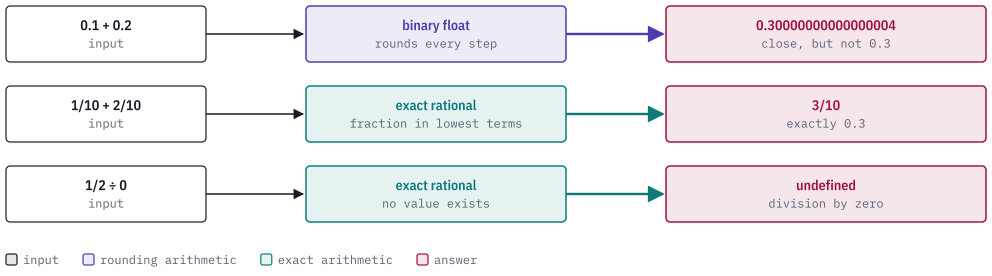
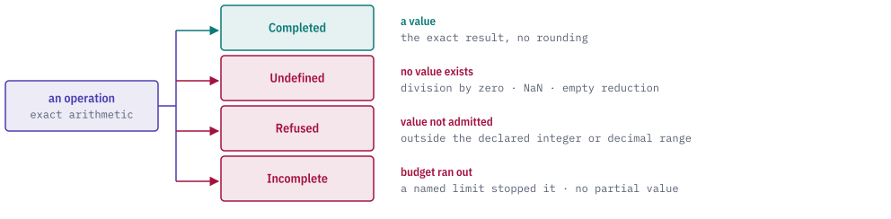

# quire-exact

quire-exact is a Rust library of exact values: integers and fractions of any
size, decimals, text, IEEE floating-point numbers, quantities and collections,
plus the checked identities and result types that go with them.

It is `no_std` (it needs only `alloc`), contains no `unsafe` code, and depends
on no other Quire crate. The layers above it use it for arithmetic with no
rounding error. When an operation has no value (dividing by zero, a result
outside its declared range, a budget that ran out), it returns a closed, named
outcome.

<picture>
  <source media="(prefers-color-scheme: dark)" srcset="docs/images/hero-dark.svg">
  
</picture>

> **Status: public prerelease.** The crate is at version 0.1.0 and is not
> published (`publish = false`). Its API is still changing. Expect breaking
> changes.

## Outcomes

Exact operations return an `Outcome<T>`, which is one of four variants:

<picture>
  <source media="(prefers-color-scheme: dark)" srcset="docs/images/outcomes-dark.svg">
  
</picture>

| Outcome | Meaning |
| --- | --- |
| `Completed(value)` | The exact result. A false Boolean is a completed value. |
| `Undefined(reason)` | The operation has no mathematical value, for example `DivisionByZero` or `IeeeNotFinite` (a NaN or infinity has no exact value). |
| `Refused(reason)` | The operation is defined, but its result is not admitted by the declared type, for example `IntegerOutOfDomain` or `InexactDecimal`. |
| `Incomplete(record)` | A named limit on a `Meter` was used up. The record says which one. No partial value exists. |

## Usage

This example is adapted from `tests/ir673_scalar.rs`, which the test suite runs.
It divides one half by zero under a `Meter` with generous limits:

```rust
use quire_exact::{
    evaluate_rational_arithmetic as rational_op, Integer, Meter, Outcome, Rational,
    RationalArithmetic, ScalarLimits, Undefined,
};

// Every operation is charged to a meter; these limits never run out.
let mut m = Meter::new(ScalarLimits {
    integer_bits: u64::MAX,
    decimal_digits: u64::MAX,
    scale_expansion: u64::MAX,
    text_input_bytes: u64::MAX,
    text_scalars: u64::MAX,
    normalized_scalars: u64::MAX,
    unit_edges: u64::MAX,
    value_occurrences: u64::MAX,
    work_units: u64::MAX,
    result_units: u64::MAX,
});
let r = |a: i64, b: i64| Rational::new(Integer::from(a), Integer::from(b)).unwrap();

let undefined = rational_op(RationalArithmetic::Divide(&r(1, 2), &r(0, 1)), None, &mut m);
assert_eq!(
    undefined.clone(),
    Outcome::Undefined(Undefined::DivisionByZero)
);
assert_eq!(undefined.completed(), None);
```

`Rational::new` reduces to lowest terms and fixes the sign, so equal fractions
are equal values. Every metered operation charges the `Meter` before it does
large work, so an oversized input produces an `Incomplete` outcome and does not
exhaust memory.

## Types

| Area | Types |
| --- | --- |
| Integers and fractions | `Integer`, `BoundedInteger`, `NonZeroInteger`, `Rational`, `RationalDomain`, integer division and modulo |
| Decimals | `Decimal`, `DecimalType`, `RoundingMode`, `DecimalResult` with its typed loss |
| IEEE floats | `IeeeValue`, `IeeeWidth`, `IeeeFlags`, exact-to-IEEE and IEEE-to-exact conversion |
| Text | `Text`, `TextProfile`, `NormalizationForm` (Unicode normalization and comparison) |
| Quantities | `Quantity`, same-unit arithmetic and comparison |
| Composite values | `Value`, `ValueType`, records, tuples, unions, collections, `ObjectReference` |
| Equality and keys | `plan_equality`, `compare_keys`, one canonical key and one equality for every value |
| Results and limits | `Outcome`, `Undefined`, `Refusal`, `Meter`, `ScalarLimits`, `Cancel` |
| Identity and provenance | `NodeKey`, `EffectiveId` and the other digest identities, `Location` |

The crate does not hash or serialize anything. Every digest identity is made
by wrapping an already-computed digest through its `from_digest` constructor,
so the crate has no wire-format or hashing dependency. Everything is
re-exported from the crate root; the modules are private.

## Cargo features

| Feature | Effect |
| --- | --- |
| `test-support` | Keeps the ordered log of every charge a `Meter` admits (`Meter::admitted_charges`), so tests can assert exact charge sequences. Enable it only from a dev-dependency. |

## Quire ecosystem

<picture>
  <source media="(prefers-color-scheme: dark)" srcset="docs/images/ecosystem-dark.svg">
  
</picture>

`quire-exact` is the bottom leaf of the stack. It depends on no other Quire
crate, only on small `no_std` libraries (`num-bigint`,
`unicode-normalization` and a few more, see `Cargo.toml`). The
[Quire Specification Language](https://github.com/agent-ix/quire-spec-language)
uses it as the shared exact-value layer under its checker and evaluator. The
rules for the values themselves (decimals, text, quantities, integer division,
IEEE profiles) are owned by `quire-specification` (private); the requirements
this repository owns are in [`spec/`](spec/).

## Building and testing

The toolchain is pinned in `rust-toolchain.toml`. Everything runs through
`make`:

| Command | What it does |
| --- | --- |
| `make test` | Run the test suite |
| `make lint` | Clippy with warnings denied, including a `no_std` target |
| `make fmt-check` | Verify formatting |
| `make build-no-std` | Build for `thumbv7em-none-eabi`, which proves nothing pulls in `std` |
| `make deny` | `cargo deny` license and advisory check |
| `make docs` | Build the docs, failing on missing or broken links |
| `make ci` | All of the above |

## Contributing

Every contribution needs a signed Contributor License Agreement; read
[`CLA.md`](CLA.md) and see [`CONTRIBUTING.md`](CONTRIBUTING.md). What may be
committed is described in [`CONTENT_RIGHTS.md`](CONTENT_RIGHTS.md).

## License

AGPL-3.0-or-later. See [`LICENSE`](LICENSE).

The standalone [Meter Kani gate](docs/meter-kani-gate.md) runs the accounting proof and its production-loop mutation control with `make kani-meter-gate`.
